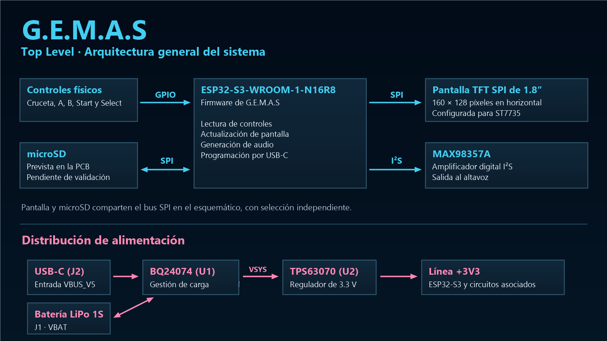

# Arquitectura y alimentación

## Arquitectura funcional

El **ESP32‑S3‑WROOM‑1‑N16R8** ejecuta el firmware, lee los botones mediante GPIO, actualiza la pantalla por SPI y envía audio digital por I²S al MAX98357A. El puerto USB‑C también proporciona la conexión de datos para programar el módulo.

*Figura 1. Arquitectura funcional y distribución de alimentación de G.E.M.A.S.*

La pantalla y el zócalo microSD comparten el bus SPI en el esquemático. Las señales `LCD_CS` y `SD_CS` permiten seleccionar cada periférico por separado. El firmware de G.E.M.A.S usa la pantalla y ejecuta la demostración sin tarjeta microSD.

## Distribución de alimentación

El puerto **USB‑C (J2)** entrega la línea `VBUS_V5` al **BQ24074 (U1)**. Este circuito administra la carga de la batería LiPo de una celda conectada a **J1** y proporciona la salida `VSYS`. El **TPS63070 (U2)** toma `VSYS` y genera la línea regulada `+3V3`.

| Línea | Función |
|---|---|
| `VBUS_V5` | Entrada de alimentación desde USB‑C. |
| `VBAT` | Conexión de la batería LiPo al circuito de carga. |
| `VSYS` | Salida del BQ24074 y entrada del regulador TPS63070. |
| `+3V3` | Alimentación regulada del ESP32‑S3 y de los circuitos conectados a esta línea. |

*Fuentes: Top Level original, esquemáticos de Altium (`Alimentacion.SchDoc`, `USB-C.SchDoc`, `ESP32.SchDoc`, `Pantalla_microSD.SchDoc` y `Audio.SchDoc`) y firmware `prueba.ino`.*

---

[Inicio](Home.md) · [Anterior · Descripción de la PCB](Descripcion_de_la_PCB.md) · [Siguiente · Pinout e interfaces](Pinout_e_interfaces.md)
