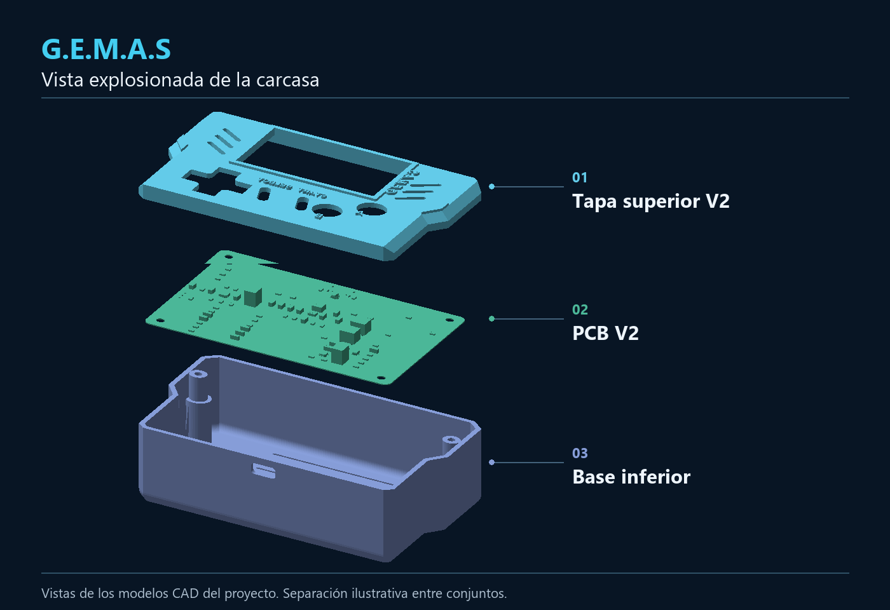
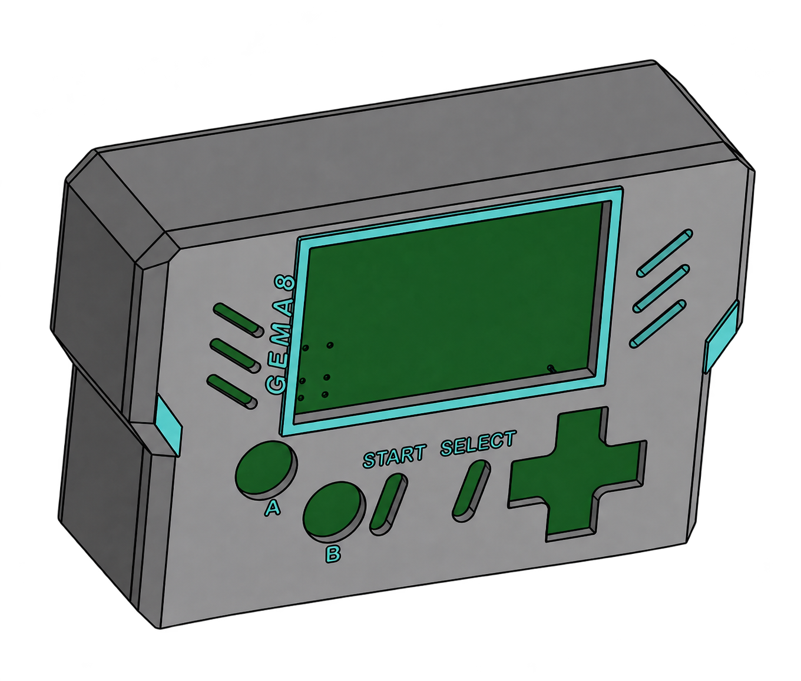
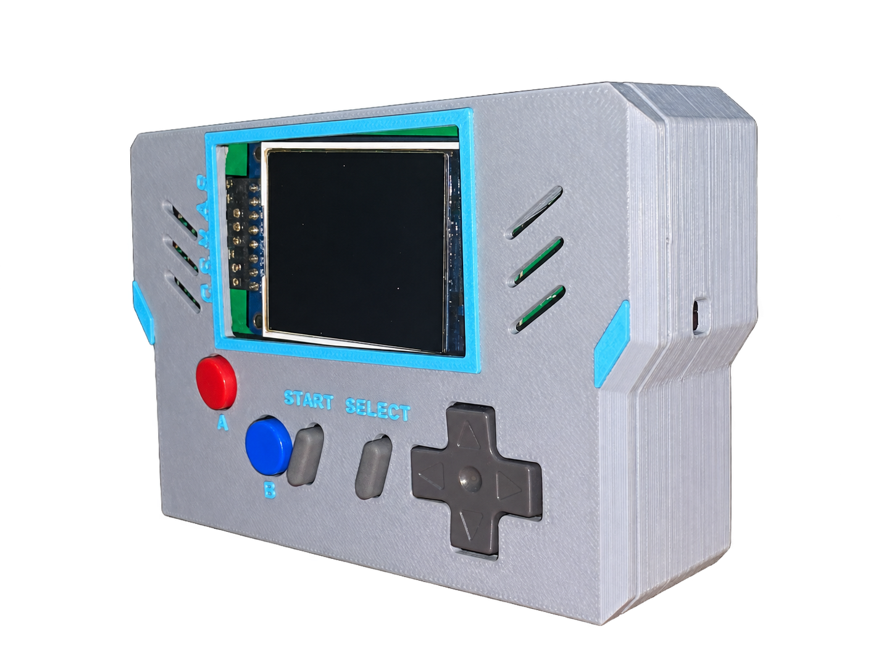

# Carcasa y ensamblaje

## Diseño mecánico

La carcasa de G.E.M.A.S se divide en una tapa superior y una base. Los modelos de la **tapa superior V2** y de la **base inferior** tienen la misma envolvente en planta, de **114 × 76 mm**. El modelo 3D de la PCB V2 mide **100 × 72 mm** en planta, lo que coincide con el contorno del Gerber archivado. Estas dimensiones se obtuvieron de los archivos del proyecto.

| Elemento | Archivo editable | Archivo de impresión |
|---|---|---|
| Tapa superior V2 | [`CarcazaSuperiorV2.SLDPRT`](../mecanica/CarcazaSuperiorV2.SLDPRT) | [`CarcazaSuperiorV2.STL`](../mecanica/CarcazaSuperiorV2.STL) |
| Base inferior | [`CarcazaInferior.SLDPRT`](../mecanica/CarcazaInferior.SLDPRT) | [`CarcazaInferior.STL`](../mecanica/CarcazaInferior.STL) |
| Ensamble de la consola | [`Consola_GEMAS.SLDASM`](../mecanica/Consola_GEMAS.SLDASM) | |
| Modelo 3D de la PCB V2 | [`PCB_GEMAS_V2_3D.SLDPRT`](../mecanica/PCB_GEMAS_V2_3D.SLDPRT) | |

*Figura 1. Vista de los modelos CAD con separación ilustrativa entre conjuntos.*

## Carcasa en CAD y prototipo ensamblado

*Modelo CAD de la carcasa.*

*Prototipo ensamblado.*

## Comprobaciones de montaje

1. **Ajuste de la PCB.** Presentar la placa en la base y comprobar que los puntos de fijación coincidan y que los componentes tengan espacio al cerrar la carcasa.
2. **Pantalla y controles.** Colocar la tapa y verificar que el área visible de la pantalla coincida con la ventana. Comprobar el recorrido y el retorno de cada botón.
3. **Acceso al USB‑C.** Probar la abertura con el cable que se usará para cargar o programar la consola. Verificar que su cubierta permita insertar el conector por completo.
4. **Cierre de la carcasa.** Revisar el acomodo de la batería, el altavoz y el cableado antes de cerrar ambas piezas.

---

[Inicio](Home.md) · [Anterior · PCB, BOM y fabricación](PCB_BOM_y_fabricacion.md) · [Siguiente · Puesta en marcha y firmware](Puesta_en_marcha_y_firmware.md)
