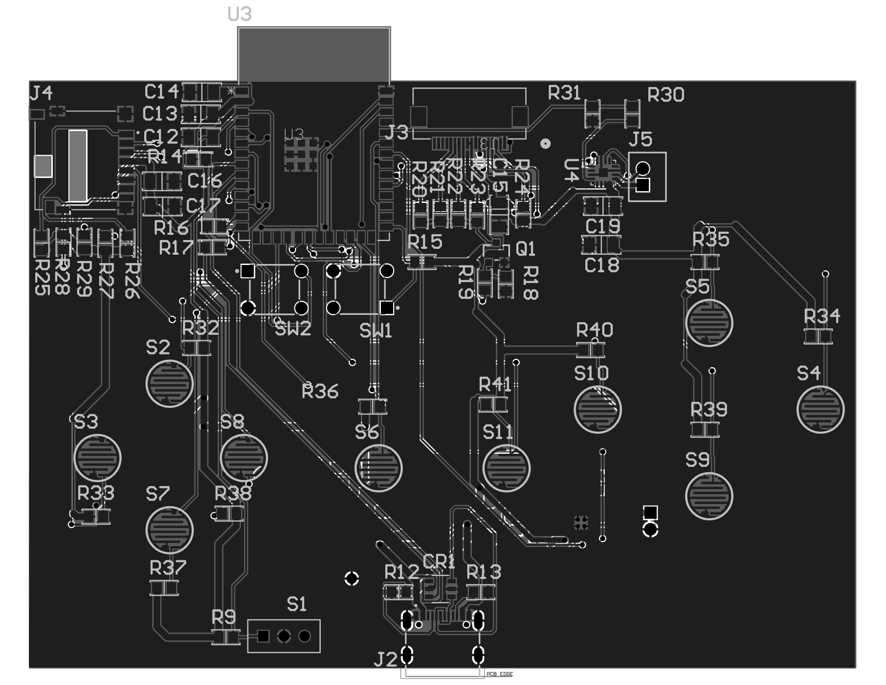
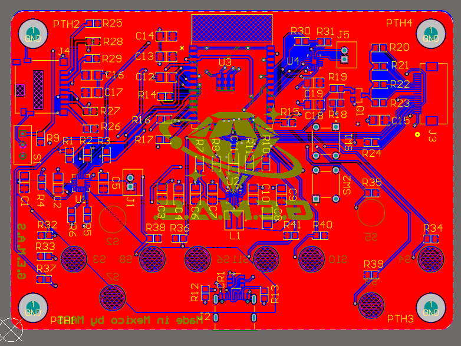

# Descripción de la PCB

La PCB de G.E.M.A.S reúne el módulo ESP32‑S3, la alimentación, las interfaces de pantalla y almacenamiento, el audio y los controles. Los identificadores de las tablas corresponden a los esquemáticos de Altium y sirven para localizar cada elemento en las vistas de la placa.

## Vista superior

*Vista de referencia del diseño exportado de Altium.*

## Vistas de diseño y placa fabricada

*Vista 2D original de las capas y los designadores.*

| Vista | Imagen |
|---|---|
| Cara superior, CAD | [Ver imagen](imagenes/PCB_superior_CAD.png) |
| Cara inferior, CAD | [Ver imagen](imagenes/PCB_inferior_CAD.png) |
| Cara inferior, placa fabricada | [Ver imagen](imagenes/PCB_inferior_real.png) |

Para consultar pistas y designadores, usa la vista 2D original o los archivos de Altium.

## Conectores

| Referencia | Elemento | Función |
|---|---|---|
| J1 | Conector de batería | Conexión de la batería LiPo de una celda. |
| J2 | USB‑C, USB4105‑GF‑A | Entrada de alimentación y conexión USB para programación. |
| J3 | Conector FPC de 18 contactos | Interfaz de pantalla prevista en el diseño de la PCB. |
| J4 | Zócalo microSD, DM3D‑SF | Interfaz de almacenamiento prevista en la PCB. |
| J5 | Conector de altavoz | Salida del amplificador hacia el altavoz. |

El conector J3 pertenece al diseño original. El prototipo utiliza un módulo TFT SPI de 1.8 pulgadas configurado en el firmware para ST7735. Consulta el cableado del módulo en [Pinout e interfaces](Pinout_e_interfaces.md).

## Circuitos integrados y protección USB

| Referencia | Componente | Función |
|---|---|---|
| U1 | BQ24074 | Gestión de carga de la batería y alimentación del sistema. |
| U2 | TPS63070 | Regulación de la línea de 3.3 V. |
| U3 | ESP32‑S3‑WROOM‑1‑N16R8 | Procesamiento, ejecución del firmware y control de periféricos. |
| U4 | MAX98357A | Amplificación de la señal de audio recibida por I²S. |
| CR1 | USBLC6‑2SC6 | Protección contra descargas electrostáticas en las líneas de datos USB. |

## Controles

| Función | Referencias |
|---|---|
| Cruceta | S2 arriba · S7 abajo · S8 izquierda · S3 derecha |
| Acciones | S5 A · S10 B |
| Menú | S11 Start · S6 Select |
| Encendido lógico | S1 |
| Entradas adicionales | S4 y S9, deshabilitadas en el firmware de demostración |

*Fuentes: esquemáticos de Altium y `firmware/prueba/prueba.ino`.*

## Esquemáticos

Hojas completas extraídas del Smart PDF de Altium.

| Hoja | Subsistema |
|---:|---|
| 1 | [Alimentación y regulación](esquematicos/01_Alimentacion.png) |
| 2 | [USB-C y protección ESD](esquematicos/02_USB_C.png) |
| 3 | [ESP32-S3](esquematicos/03_ESP32_S3.png) |
| 4 | [Audio](esquematicos/04_Audio.png) |
| 5 | [Controles](esquematicos/05_Controles.png) |
| 6 | [Pantalla y microSD](esquematicos/06_Pantalla_y_microSD.png) |

[Smart PDF completo](../recursos/documentos/GEMAS-Guereca%20Entertainment%20Mini%20Arcade%20System.pdf)

---

[Inicio](Home.md) · [Siguiente · Arquitectura y alimentación](Arquitectura_y_alimentacion.md)
