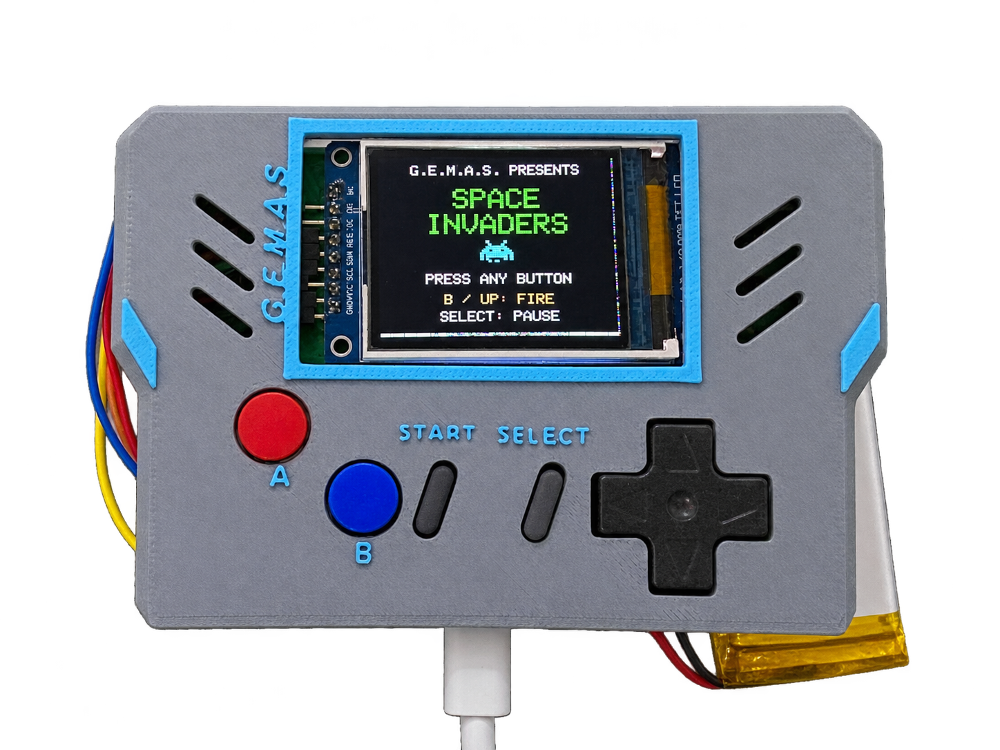

# Guereca Entertainment Mini Arcade System (G.E.M.A.S)

G.E.M.A.S es una consola portátil de videojuegos basada en el **ESP32‑S3**, con PCB y carcasa de diseño propio. Integra una pantalla a color, controles físicos y audio por altavoz. Esta wiki reúne los esquemáticos, archivos de fabricación, modelos de la carcasa y código fuente para entender, programar y ensamblar el prototipo.

*Prototipo de G.E.M.A.S. en funcionamiento.*

## Especificaciones principales

| Subsistema | Descripción |
|---|---|
| Procesador y memoria | ESP32‑S3‑WROOM‑1‑N16R8 con 16 MB de memoria flash y 8 MB de PSRAM. |
| Pantalla | TFT a color por SPI. El firmware de demostración usa el controlador ST7735 y una resolución de 160 × 128 píxeles en horizontal. |
| Controles | Cruceta de cuatro direcciones y botones A, B, Start y Select habilitados en la demostración. |
| Audio | Amplificador MAX98357A conectado por I²S para la salida al altavoz. |
| Alimentación y programación | Batería LiPo de una celda y puerto USB‑C para carga y programación. |
| Almacenamiento | Interfaz microSD prevista en la PCB. Su validación queda pendiente. La demostración funciona sin tarjeta. |

## Firmware de G.E.M.A.S

El firmware de G.E.M.A.S gestiona la pantalla, la lectura de los controles y la salida de audio. La demostración se inicia al presionar cualquiera de los ocho controles habilitados. El código fuente se encuentra en [`firmware/prueba/prueba.ino`](../firmware/prueba/prueba.ino).

## Índice de documentación técnica

| Área técnica | Secciones |
|---|---|
| Hardware e interfaces | [Descripción de la PCB](Descripcion_de_la_PCB.md) · [Arquitectura y alimentación](Arquitectura_y_alimentacion.md) · [Pinout e interfaces](Pinout_e_interfaces.md) |
| Fabricación y diseño mecánico | [PCB, BOM y fabricación](PCB_BOM_y_fabricacion.md) · [Carcasa y ensamblaje](Carcasa_y_ensamblaje.md) |
| Firmware y validación | [Puesta en marcha y firmware](Puesta_en_marcha_y_firmware.md) · [Pruebas y solución de problemas](Pruebas_y_solucion_de_problemas.md) |
